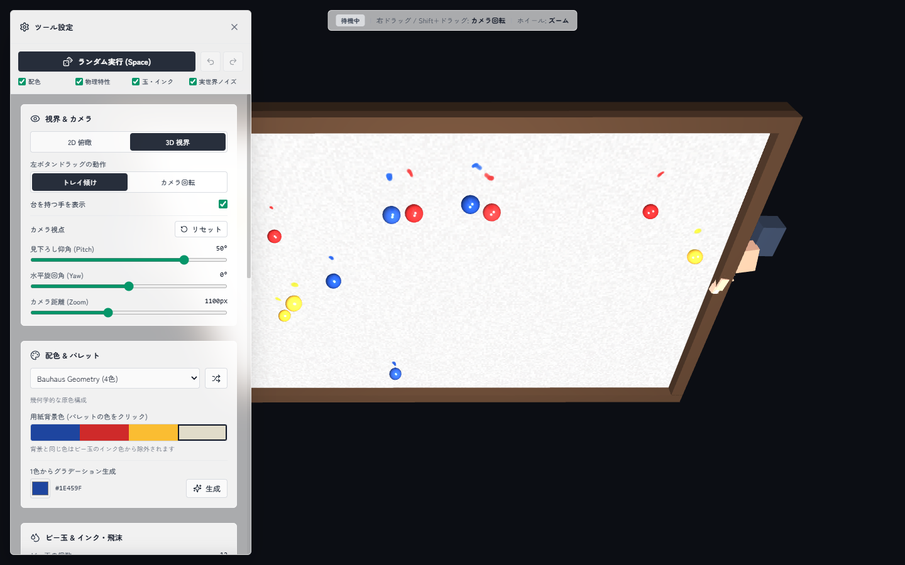

# rolling-marble-canvas

木枠トレイの上でビー玉を転がし、インクの軌跡で絵を描くジェネラティブアート・スタジオ。



## 目次

1. [概要](#1-概要)
2. [仕組み](#2-仕組み)
3. [構造](#3-構造)
4. [実行方法](#4-実行方法)
5. [操作方法](#5-操作方法)
6. [出力ファイル](#6-出力ファイル)
7. [テスト](#7-テスト)
8. [導入を見送ったもの](#8-導入を見送ったもの)

## 1. 概要

手でトレイを傾けるように、マウスドラッグでビー玉を転がします。ビー玉に付いた絵の具が用紙に転写され (重なった部分は乗算で混ざります)、転がるほどかすれ、壁や玉同士の衝突で飛び散ります。3D 視界 (360度カメラ操作) と 2D 俯瞰を切り替えられ、高解像度 PNG と 60fps の MP4 動画で書き出せます。

もともと 1 ファイル (約 3000 行) の `index.html` だったものを、React + TypeScript に分割しました。UI は p5-react-template のグラスモルフィズム (半透明 + blur) に合わせています。

## 2. 仕組み

- 言語: TypeScript
- フレームワーク: React 18
- ビルド: Vite
- パッケージマネージャー: pnpm
- 描画: p5.js 1.x (WEBGL、インスタンスモード)
- 状態管理: Jotai
- UI アニメーション: Framer Motion
- アイコン: Lucide React
- CSS: Tailwind CSS 3
- 動画: WebCodecs + mp4-muxer (H.264 の MP4 を直接出力。非対応ブラウザは MediaRecorder の WebM にフォールバック)
- コード品質: Biome (整形・Lint)、knip (未使用コード検出)
- テスト: Vitest

物理演算は p5.js に依存しない純粋な TypeScript (`src/core/physics/`) に分けてあります。物理は「描画してほしい出来事 (飛沫・衝突)」をイベントとして返し、描画側 (`src/core/render/`) がそれを用紙バッファに描きます。この分離のおかげで、ブラウザなしでテストできます。

## 3. 構造

```text
rolling-marble-canvas/
├── index.html
├── package.json
├── biome.json
├── tsconfig.json
├── vite.config.ts
├── tailwind.config.js
├── postcss.config.js
├── .gitignore
├── README.md
├── docs/
│   └── screenshot.png
├── output/                         - 保存した画像・動画・JSON の置き場 (中身は Git 管理外)
├── tests/                          - Vitest のテスト
└── src/
    ├── main.tsx
    ├── App.tsx
    ├── index.css
    ├── types/
    │   └── simulation.ts           - 設定・パレット・用紙サイズなどの型
    ├── constants/
    │   ├── defaults.ts             - 既定の設定値、カメラの可動範囲
    │   └── palettes.ts             - プリセット 28 パレット
    ├── state/
    │   ├── store.ts                - Jotai のアトム (設定・履歴・録画状態など)
    │   ├── actions.ts              - 設定変更・Undo/Redo・ランダム化・JSON 入出力
    │   ├── recordingActions.ts     - 録画開始/停止、n Loop 録画
    │   ├── bridge.ts               - p5 スケッチからストアを読み書きする橋渡し
    │   └── toast.ts                - 画面右下の通知
    ├── core/
    │   ├── sketch.ts               - p5 のライフサイクル (setup / draw / マウス操作)
    │   ├── config.ts               - 設定 JSON の生成と検証付き復元
    │   ├── exporter.ts             - 高解像度 PNG と JSON の保存
    │   ├── recorder.ts             - WebCodecs / mp4-muxer による動画録画
    │   ├── physics/
    │   │   ├── marble.ts           - ビー玉 1 個の物理 (重力・摩擦・ノイズ・壁反発)
    │   │   ├── collisions.ts       - ビー玉同士の弾性衝突
    │   │   ├── simulation.ts       - ビー玉群の生成と 1 フレーム分の進行
    │   │   └── tray.ts             - キャンバスサイズから用紙サイズを決定
    │   └── render/
    │       ├── inkPainter.ts       - インク軌跡・遠心スプラッシュ・衝突スプラッターの描画
    │       ├── marbleRenderer.ts   - ガラス球 (3D / 2D)
    │       ├── trayRenderer.ts     - 木枠トレイ・用紙・グレイン
    │       ├── handsRenderer.ts    - トレイを持つ手
    │       └── debugRenderer.ts    - 物理デバッグ表示
    ├── components/                 - ControlPanel と各セクション、録画 HUD、トースト
    ├── hooks/
    │   ├── useKeyboardShortcuts.ts - グローバルショートカット
    │   ├── useAutoModulation.ts    - 周期自動ランダム変調
    │   └── useWheelRangeSlider.ts  - スライダー上のホイール操作
    └── utils/
        ├── palette.ts              - インク色の抽出、背景色の補正、グラデーション生成
        ├── randomizer.ts           - パラメータのランダム化と周期変調
        └── p5Graphics.ts           - p5.Graphics の安全な破棄
```

## 4. 実行方法

| コマンド | 実行内容 |
| --- | --- |
| `pnpm install` | 依存パッケージのインストール |
| `pnpm dev` | 開発サーバーの起動 (タブタイトルに `[DEV]` が付く) |
| `pnpm build` | 型チェックと本番ビルド |
| `pnpm preview` | ビルド結果のプレビュー |
| `pnpm test` | テストを 1 回実行 |
| `pnpm test:watch` | テストを監視実行 |
| `pnpm check` | Biome による Lint と整形の確認 |
| `pnpm format` | Biome による自動整形 |
| `pnpm knip` | 未使用のファイル・export・依存の検出 |

開発サーバー (`pnpm dev`) では、スクリーンショットで描画を確認するためのクエリ引数が使えます。

| 引数 | 動作 |
| --- | --- |
| `?warmup=<N>` | 最初のフレームで物理を N ステップ早送りし、軌跡が描かれた状態から始める |
| `?panel=0` | 設定パネルを閉じた状態で開く |

## 5. 操作方法

マウス操作は、キャンバス上でのみ有効です。

| 操作 | 動作 |
| --- | --- |
| 左ドラッグ | トレイを傾ける (設定でカメラ回転に変更可) |
| 右ドラッグ / Shift + ドラッグ | カメラ回転 (3D 視界のみ) |
| ホイール | ズーム (3D 視界のみ) |

キーボードショートカット:

| キー | 動作 |
| --- | --- |
| `Space` | 選択した対象のパラメータをランダム設定 |
| `H` | ツール設定パネルの開閉 |
| `Ctrl+Z` / `U` | 元に戻す |
| `Ctrl+Y` / `Ctrl+Shift+Z` | やり直す |
| `R` | MP4 録画の開始 |
| `S` | 録画の停止・保存 |
| `P` | 高解像度 PNG と設定 JSON の保存 |
| `C` | 紙を交換 (軌跡を消去) |
| `T` | 自動トレイ揺動の切り替え |

パネルの外側をクリックするとパネルが閉じます。再び開くには `H` か左上の歯車ボタンを使います。

分割前の版からの変更点: `Space` は「自動揺動の切り替え」から「ランダム設定」に変わり、自動揺動の切り替えは `T` に移りました (p5-react-template のショートカットに合わせたため)。

## 6. 出力ファイル

ブラウザの保存機能で書き出されるため、アプリから `output/` へ直接は保存されません。ダウンロードしたファイルを `output/` に移して整理してください。`output/` の中身は `.gitignore` で Git 管理から外してあり、フォルダ自体は `.gitkeep` で維持しています。

| 種類 | ファイル名 | 内容 |
| --- | --- | --- |
| 画像 | `RollingMarbleCanvas_<日時>_<幅>x<高さ>.png` | 用紙のみ (木枠・ビー玉・手なし) の、長辺 2560px 以上の高解像度画像 |
| 動画 | `RollingMarbleCanvas_<日時>.mp4` | 60fps H.264 (非対応環境は `.webm`) |
| n Loop 動画 | `RollingMarbleCanvas_<日時>_nloop_<N>x<周期>ms.mp4` | 変調周期 × N ループちょうどの長さ |
| 設定 | 上記と同名の `.json` | 画像・動画の保存時に自動で付与。読み込めば再現できる |

## 7. テスト

`pnpm test` で、次の内容を検証します。

- `tests/bounds.test.ts`: はみ出しの検証
    - 最大個数・最大サイズ・最大反発係数などの条件で数千ステップ動かしても、全フレームでビー玉が用紙の内側に収まる
    - 木枠込みのトレイ外形が、300x300 から 4K までのキャンバスに収まる
- `tests/collisions.test.ts`: ビー玉同士の重なり解消と速度交換
- `tests/randomizer.test.ts`: ランダム化・周期変調の結果が、UI スライダーの範囲内に収まる
- `tests/palette.test.ts`: 28 パレットの整合性、インク色の抽出、グラデーション生成
- `tests/config.test.ts`: 設定 JSON の保存と復元、壊れた入力の拒否

はみ出しテストは、ビー玉同士の押し出しで壁の外に出る不具合を検出しました (分割前の版では、衝突の後に位置を補正していませんでした)。現在は衝突解決の後に用紙内へ補正しています。

描画 (WebGL) と動画録画は、ブラウザが必要なため自動テストの対象外です。

## 8. 導入を見送ったもの

| ライブラリ | 理由 |
| --- | --- |
| p5.js-svg | 3D (WEBGL) の描画で、軌跡もラスタのバッファのため、SVG にできる要素がない |
| Storybook | UI は設定パネルのみで、コンポーネント単体で確認する場面が少ない |
| open-props | Tailwind CSS で足りており、スタイルの仕組みを二重にしない |
